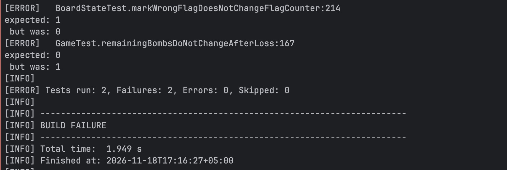

# BUG-001: Remaining Mines Counter Changes After Losing

| Field            | Value                                                                 |
|------------------|-----------------------------------------------------------------------|
| Status           | Fixed                                                                 |
| Severity         | Low (display logic defect; the game remains functional)               |
| Priority         | Low                                                                   |
| Component        | core / `BoardState.markWrongFlag`                                     |
| Discovered       | 2026-11-18, while writing `Game` unit tests                           |
| Reproducing Test | `GameTest.remainingBombsDoNotChangeAfterLoss` (currently `@Disabled`) |

## Description

When the player loses, the board is revealed, and incorrectly placed flags (flags on safe cells) are marked with a cross.
However, each incorrectly placed flag decreases the internal flag counter. 
As a result, the displayed number of remaining mines changes after the game has ended.

## Steps to Reproduce

1. Start a game at any difficulty and make the first move.
2. Place a flag on a cell known to be safe.
3. Note the current value of the MINES counter.
4. Reveal a cell containing a mine.

## Actual Result

The game ends, and the incorrectly placed flag is marked with a cross. 
However, the MINES counter increases by the number of incorrectly placed flags.

For example, if the counter was N, it becomes N + number of incorrectly placed flags.

## Expected Result

The counter value should remain unchanged after the game ends. 
It should display the same value as it did immediately before the losing move.

## Automated Reproduction

The test GameTest.remainingBombsDoNotChangeAfterLoss uses a 2×2 board with a mine at (0,0):
1. First move at (1,1).
2. Place an incorrect flag at (1,0).
3. Reveal the mine at (0,0).
Before losing, getRemainingBombs() returns 0. After losing, it returns 1.
The test is currently disabled using:@Disabled("BUG-001...")
Removing this annotation causes the test to fail.

## Suspected Root Cause

The method BoardState.markWrongFlag performs an unintended decrement of the flag counter:
flaggedCount--
In addition to changing the cell state to WRONG_FLAG, it modifies the internal counter.

## Proposed Fix

Remove the flaggedCount-- operation from BoardState.markWrongFlag, ensuring that marking an incorrect flag 
after the game ends does not affect the remaining mines counter.

## Red run (before the fix)

