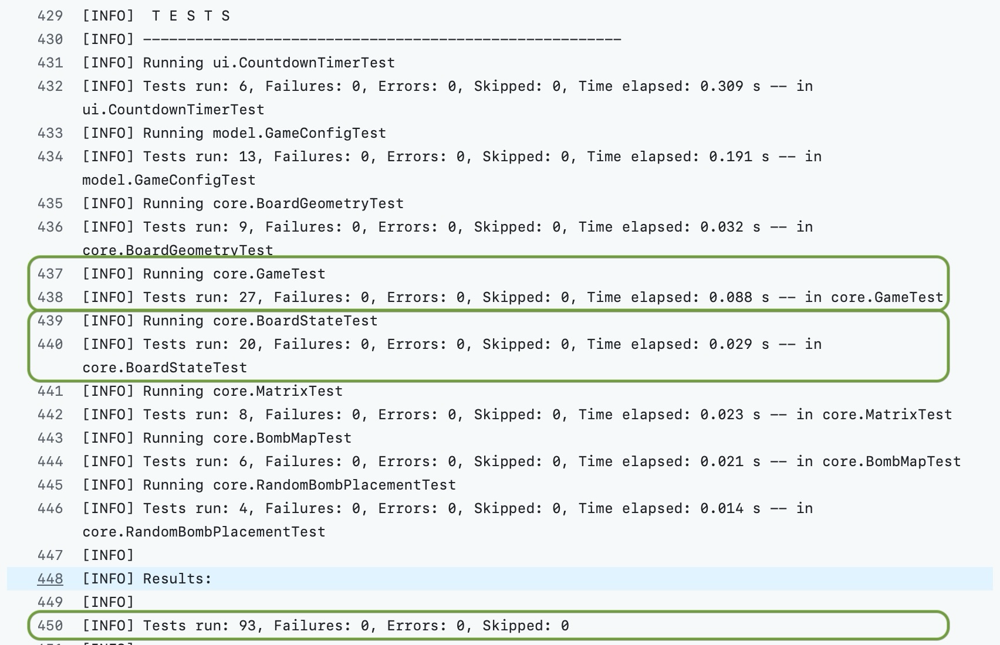

# BUG-001: MINES counter increases by the number of wrong flags after losing the game

## TL;DR

When the player loses, each wrongly placed flag is marked `WRONG_FLAG` and also decrements the internal flag counter, so the displayed MINES value changes after the game has ended.
Display-only defect: the game outcome and game logic are not affected. Fixed, regression tests added.

| Field               | Value                                                                                                |
|---------------------|------------------------------------------------------------------------------------------------------|
| ID                  | BUG-001                                                                                              |
| Status              | Closed (Fixed 2026-11-18 → Verified 2026-11-18 → Closed 2026-11-18 by NemcNk)                        |
| Severity            | Minor (display logic defect; wrong value displayed, the game remains fully playable)                 |
| Priority            | Low (no workaround needed, no data loss, fixed together with tests)                                  |
| Reproducibility     | Always (deterministic)                                                                               |
| Component           | core / `BoardState.markWrongFlag`                                                                    |
| Found in            | `CI #6 Pull request #1`                                                                                |
| Fixed in            | `CI #7 Pull request #1`                                                                                |
| Environment         | `JDK 25.0.1`, `MacOS`, `IntelliJ IDEA`                                                                     |
| Reported / Assignee | `NemcNk` / `NemcNk`                                                                                      |
| Detected            | 2026-11-18, while writing `Game` unit tests                                                          |
| Regression tests    | `GameTest.remainingBombsDoNotChangeAfterLoss`, `BoardStateTest.markWrongFlagDoesNotChangeFlagCounter` |

## Preconditions

* Open the minesweeper app.
* Start a game at any difficulty and make the first move.

## Steps to Reproduce

1. Place a flag on a cell known to be safe.
2. Note the current value of the MINES counter.
3. Reveal a cell containing a mine.

## Actual Result

The game ends, and the incorrectly placed flag is marked with a cross. 
However, the MINES counter increases by the number of incorrectly placed flags.

For example, if the counter was N, it becomes N + number of incorrectly placed flags.

## Expected Result

The counter value should remain unchanged after the game ends. 
It should display the same value as it did immediately before the losing move.

## Impact

UI shows an incorrect number after the game ends. No effect on game outcome, other components or data.

## Automated Reproduction

The test `GameTest.remainingBombsDoNotChangeAfterLoss` uses a 2×2 board with a mine at (0,0):
1. First move at (1,1).
2. Place an incorrect flag at (1,0).
3. Reveal the mine at (0,0).
   
Before the fix, `getRemainingBombs()` returned 0 before the loss and 1 after it, so the test failed (see the red run below). With the fix, both values are 0.
`BoardStateTest.markWrongFlagDoesNotChangeFlagCounter` checks the same rule directly on `BoardState`.

## Root Cause

`BoardState.markWrongFlag` performed an unintended `flaggedCount--`. 
In addition to changing the cell state to `WRONG_FLAG`, it modified the internal flag counter.

## Resolution

Removed `flaggedCount--` from `BoardState.markWrongFlag`. 
The cell state still changes to `WRONG_FLAG`, but marking wrong flags when the board is revealed after a loss no longer affects the counter. 
Reference: `CI #7 Pull request #1`.

## Verification

- Confirmation: both regression tests are red before the fix and green after it (see Evidence).
- Regression: the full automated test suite is green in CI (`CI #7 Pull request #1`).

## Evidence

- Fig. 1. Red run of `GameTest` & `BoardStateTest` before the fix: 

- Fig. 2. Green run of `GameTest` & `BoardStateTest` after the fix: 

